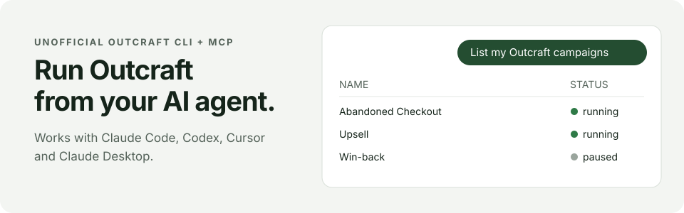

<div align="center">

# Outcraft for AI agents

**Read and manage your [Outcraft](https://outcraft.ai) campaigns by chatting with your AI agent.**

[](https://github.com/Aduomas/outcraft-cli/actions/workflows/ci.yml)


[**Claude Code**](#claude-code) · [**Codex**](#codex) · [**Cursor**](#cursor) · [**Claude Desktop**](#claude-desktop) · [**Other apps**](#other-mcp-apps) · [**For agents**](#for-ai-agents)



</div>

> [!NOTE]
> Not affiliated with Outcraft. It drives the same pages as the Outcraft dashboard, so a dashboard redesign can break it.

## Quick start

**About 5 minutes. No coding needed.**

1. **Open an AI agent that can use your computer's terminal.** Either works:
   - [Claude Code](https://claude.com/claude-code) (desktop app or terminal)
   - [Codex](https://openai.com/codex) (desktop app or terminal)
2. **Copy this prompt and paste it into the agent.** Use the copy button on the right of the box.

   ```text
   Set up https://github.com/Aduomas/outcraft-cli so I can
   manage Outcraft from this agent. Connect it with: CLI + skill.
   Follow the "For AI agents" section of its README exactly,
   then tell me what passed.
   ```

   Want MCP instead? Change `CLI + skill` to `MCP`. [Which one?](#cli--skill-or-mcp)
3. **Add your Outcraft login when the agent asks.** It creates a private file on your computer for your email and password. Type them into that file, **never into the chat**.
4. **Start a new chat and say:** "List my Outcraft campaigns."

> [!IMPORTANT]
> You need an Outcraft **email and password** login. Google sign-in, two-factor codes and CAPTCHAs are not supported. Web chats like claude.ai or chatgpt.com cannot install this; use one of the apps above.

## CLI + skill or MCP?

**Pick one. Both give your agent the same campaign powers.**

| | CLI + skill | MCP |
| --- | --- | --- |
| **How it works** | Your agent runs `outcraft` commands; a skill file teaches it how | Your app gets built-in Outcraft tools |
| **Best for** | Claude Code, Codex | Cursor, Claude Desktop, any app without a terminal |
| **Adds to every chat** | Only a 1-line skill description | 13 tool definitions |
| **After setup** | Start a new chat | Start a new chat; desktop apps need a restart |

Not sure? Use **CLI + skill** in Claude Code or Codex, **MCP** everywhere else.

## What you can ask

| Say this | What happens |
| --- | --- |
| "List my Outcraft campaigns" | Shows names, IDs and status. Read-only. |
| "Show the sequence for campaign 123" | Shows that campaign's email steps. Read-only. |
| "Rename campaign 123 to Abandoned Checkout v2" | Asks you to confirm, then renames it. |
| "Pause campaign 123" | Asks you to confirm, then pauses it. |
| "Duplicate campaign 123" | Asks you to confirm, then copies it. |

**Every change needs your confirmation first.** "Delete" archives a campaign; nothing is permanently deleted. Publishing a campaign and launching it are 2 separate steps.

## Connect your app

The quick start does this for you. Use these to set it up by hand, after [Install by hand](#install-by-hand) in `~/outcraft-cli`. Replace `/Users/you` with your home folder (`/home/you` on Linux).

<a id="claude-code"></a>
<details>
<summary><b>Claude Code</b></summary>

**CLI + skill:**

```bash
mkdir -p ~/.claude/skills && ln -s ~/outcraft-cli/skills/outcraft ~/.claude/skills/outcraft
```

**Or MCP:**

```bash
claude mcp add --transport stdio --scope user outcraft -- \
  /Users/you/outcraft-cli/.venv/bin/outcraft-mcp --env-file /Users/you/outcraft-cli/.env
```

Start a new session and ask "List my Outcraft campaigns." For MCP, `/mcp` also shows `outcraft`.

</details>

<a id="codex"></a>
<details>
<summary><b>Codex</b></summary>

**CLI + skill:**

```bash
mkdir -p ~/.agents/skills && ln -s ~/outcraft-cli/skills/outcraft ~/.agents/skills/outcraft
```

**Or MCP**, with the command or by adding to `~/.codex/config.toml`:

```bash
codex mcp add outcraft -- \
  /Users/you/outcraft-cli/.venv/bin/outcraft-mcp --env-file /Users/you/outcraft-cli/.env
```

```toml
[mcp_servers.outcraft]
command = "/Users/you/outcraft-cli/.venv/bin/outcraft-mcp"
args = ["--env-file", "/Users/you/outcraft-cli/.env"]
```

Start a new session and ask "List my Outcraft campaigns." For MCP, `/mcp` also shows `outcraft`.

</details>

<a id="cursor"></a>
<details>
<summary><b>Cursor</b> (MCP)</summary>

Merge this into `~/.cursor/mcp.json`, then restart Cursor:

```json
{
  "mcpServers": {
    "outcraft": {
      "command": "/Users/you/outcraft-cli/.venv/bin/outcraft-mcp",
      "args": ["--env-file", "/Users/you/outcraft-cli/.env"]
    }
  }
}
```

</details>

<a id="claude-desktop"></a>
<details>
<summary><b>Claude Desktop</b> (MCP)</summary>

Open **Settings > Developer > Edit Config** and merge this into `claude_desktop_config.json`, then quit and reopen Claude:

```json
{
  "mcpServers": {
    "outcraft": {
      "command": "/Users/you/outcraft-cli/.venv/bin/outcraft-mcp",
      "args": ["--env-file", "/Users/you/outcraft-cli/.env"]
    }
  }
}
```

</details>

<a id="other-mcp-apps"></a>
<details>
<summary><b>Other apps</b></summary>

**MCP:** any app that runs local **stdio** MCP servers works. Point it at:

| Field | Value |
| --- | --- |
| Command | `/Users/you/outcraft-cli/.venv/bin/outcraft-mcp` |
| Arguments | `--env-file /Users/you/outcraft-cli/.env` |

**CLI + skill:** agents that read `SKILL.md` skills can load [`skills/outcraft`](skills/outcraft/SKILL.md) from their skills folder.

Keep your password in the `.env` file, not in the app's settings.

</details>

## Install by hand

<details>
<summary>Install steps and CLI commands</summary>

Needs Python 3.11+ on macOS or Linux.

```bash
git clone https://github.com/Aduomas/outcraft-cli ~/outcraft-cli
cd ~/outcraft-cli
python3 -m venv .venv
.venv/bin/python -m pip install -e '.[browser,mcp]'
.venv/bin/python -m playwright install --only-shell chromium
[ -f .env ] || cp .env.example .env
chmod 600 .env
```

Open `.env` in a text editor and fill in `OUTCRAFT_EMAIL` and `OUTCRAFT_PASSWORD`. Then:

```bash
.venv/bin/outcraft --env-file .env auth login
.venv/bin/outcraft --env-file .env campaigns list
.venv/bin/outcraft --env-file .env campaigns show 123 --section sequence
.venv/bin/outcraft --env-file .env campaigns rename 123 'New name' --yes
.venv/bin/outcraft --env-file .env leads count --campaign 123
.venv/bin/outcraft --env-file .env analytics --campaign 123 --range 30d
.venv/bin/outcraft --help
```

On Linux, Chromium may need system libraries: `.venv/bin/python -m playwright install-deps chromium` (needs admin rights).

</details>

## For AI agents

You are setting this up for a user who may not be technical. Follow these steps in order and report honestly.

1. **Install.** Use `~/outcraft-cli` (the skill expects this path); reuse an existing checkout there without overwriting local changes. Run the commands in [Install by hand](#install-by-hand): an isolated `.venv`, the `browser` and `mcp` extras, and Playwright's Chromium headless shell. Ask before any `sudo` or other admin change.
2. **Credentials.** Create `.env` from `.env.example` with `chmod 600`; keep any values already there. Ask the user to type `OUTCRAFT_EMAIL` and `OUTCRAFT_PASSWORD` into that file themselves, or use a private secret prompt if your host has one. Never ask for the password in chat, print it, or place it in MCP settings. Do not `source` the file.
3. **Connect, 1 mode only.** Use the mode in the user's prompt; default to CLI + skill when your host loads skills, otherwise MCP.
   - **CLI + skill:** symlink `~/outcraft-cli/skills/outcraft` into your host's user skills folder (Claude Code `~/.claude/skills/`, Codex `~/.agents/skills/`). Keep existing skills.
   - **MCP:** register the stdio server in your host with absolute paths for both `outcraft-mcp` and `--env-file` (see [Connect your app](#connect-your-app)). Keep the user's other MCP servers.
   - If your host cannot run local commands or stdio MCP, say so instead of claiming success.
4. **Verify read-only.** Run `outcraft --env-file ~/outcraft-cli/.env auth login`, then `campaigns list` with the same flag. Confirm the skill or MCP tools are discoverable; if that needs a new session, say exactly what is still unverified. **Do not create, edit, archive, publish or launch anything during setup.**
5. **Report.** Give the install path, the mode, each check that actually passed, and the 1 next action the user must take. Configuration alone is not a working connection.

**Rules after setup** (the skill carries these for CLI mode):

| Rule | Detail |
| --- | --- |
| Writes need explicit consent | CLI writes need `--yes`; MCP writes need `confirm: true`. Only set them after the user asks for that exact change. |
| Never auto-retry a failed write | Resuming a campaign can contact real leads. Re-read the campaign state instead. |
| Delete means archive | `campaigns delete` and `archive_campaign` archive; nothing is permanently deleted. |
| Publish is not launch | `publish_campaign` and `set_campaign_running` are separate steps. |
| Dry runs are free | `--dry-run` sends no requests. |

**MCP tools:** `list_campaigns`, `get_campaign`, `campaign_sections`, `export_campaign`, `list_leads`, `count_leads`, `get_lead`, `get_analytics`, `inspect_dashboard` (read); `create_campaign`, `rename_campaign`, `update_campaign`, `set_campaign_running`, `archive_campaign`, `duplicate_campaign`, `publish_campaign`, `campaign_action` (write).

## How it works

- **Login:** Playwright opens a temporary headless browser, signs in with your `.env` login, then closes. No personal Chrome profile, stealth browser or CAPTCHA solver is used.
- **Requests:** HTTPX makes the campaign requests using that saved session.
- **Storage:** the session is saved on your computer with owner-only permissions. `outcraft auth logout` removes it.
- **MCP:** runs over stdio, opens no network port, and signs in only when a tool needs it.

## Known limits

Session handoff from browser to HTTPX passed 3 live checks against Outcraft's login endpoint. **Real password login and authenticated campaign writes have not yet been verified live**, and a successful submit does not prove a campaign was published or launched. Details in [docs/verification.md](docs/verification.md); request internals in [docs/protocol.md](docs/protocol.md).
